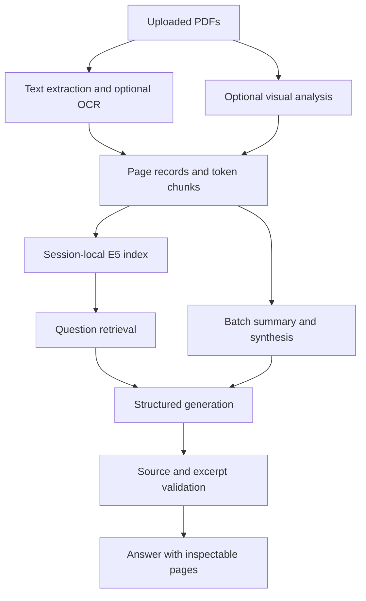

# IntelliResearch

A Streamlit research assistant for English and Arabic PDFs. Upload papers once,
ask follow-up questions, generate a combined summary, and inspect the source pages
behind each answer. Optional OCR handles scanned pages; optional Gemini vision
adds descriptions of figures and tables, including vector drawings.

**Status:** a refactored prototype with 25 passing offline regression tests. Real-paper answer
quality still needs evaluation with fresh credentials. Exact source matching is
implemented; semantic correctness is not guaranteed.

## What it does

- Extracts native PDF text and optionally runs Tesseract on pages with little text.
- Keeps document identity, page number, text, and visual interpretations separate.
- Builds a session-local multilingual E5 index once after an explicit processing step.
- Answers questions using retrieved passages and recent conversation history.
- Requires each factual claim to cite an existing source and quote an exact excerpt.
- Declines when the model reports insufficient evidence; never silently falls back
  to an ungrounded assistant or invents external references by design.
- Summarizes all indexed passages in batches, then synthesizes their checked excerpts.
- Extracts chart data into a constrained schema. Labels and values must occur in
  quoted text; you inspect the table before rendering a bar or line chart.

## Run locally

Use Python 3.12. Commands below work in Linux, macOS, or WSL:

```bash
git clone https://github.com/OthmanBadr/IntelliResearch.git
cd IntelliResearch
python -m venv .venv
source .venv/bin/activate

# CPU build avoids downloading GPU runtimes on a CPU-only machine.
pip install torch --index-url https://download.pytorch.org/whl/cpu
pip install -r requirements.txt
streamlit run app.py
```

On Windows PowerShell, activate with `.venv\Scripts\Activate.ps1`.
Enter a **new, unexposed Gemini key** in the sidebar, or set `GEMINI_API_KEY` in your
environment before starting Streamlit. `GOOGLE_API_KEY` is accepted for compatibility.
Do not put credentials in source files. `.env.example` documents variable names;
the application does not automatically load `.env` files.

The default model is the configurable `gemini-flash-latest` alias. Model availability,
quotas, pricing and behavior can change; use `GEMINI_MODEL` or the sidebar to choose
a model available to your account that supports images and structured JSON output.
Record the resolved model/version for reproducible evaluations.

The first indexing operation downloads `intfloat/multilingual-e5-small` weights
from Hugging Face. Subsequent sessions reuse the locally cached weights. No GPU
is required; larger uploads may be slow on a CPU.

### Optional OCR

For Ubuntu/WSL:

```bash
sudo apt-get update
sudo apt-get install tesseract-ocr tesseract-ocr-eng tesseract-ocr-ara
```

Enable **OCR scanned pages** and choose the installed language packs. For Windows,
install Tesseract and add its executable to `PATH`. PyMuPDF renders pages directly;
Poppler is not required. OCR is attempted on pages with fewer than 30 native text
characters; mixed scanned/native pages may need a more advanced layout pipeline.

### Typical workflow

1. Upload up to five PDFs (20 MB each; 100 pages in total).
2. Choose OCR and figure analysis options, then click **Process documents**.
3. Ask a question in **Ask your papers**. Expand **Inspect source passages** to
   compare the evidence with rendered PDF pages.
4. In **Research summary**, choose English or Arabic and explicitly generate a summary.
   Click a suggested question to send that exact question to the document assistant.
5. In **Charts**, describe a comparison of printed numeric values, inspect the
   extracted table, then click **Plot these values**.

Changing uploads or processing options clears stale indexes, summaries, chat, and
pending charts. Ordinary widget reruns and chat questions do not reprocess uploads.
Data stays in the browser session's server-side memory and is lost when the
session ends; this version does not provide a persistent document library.

## Architecture



| Module | Responsibility |
|---|---|
| `app.py` | Streamlit controls, session lifecycle, chat, summaries, chart review |
| `intelliresearch/ingestion.py` | PDF validation, extraction, OCR, page rendering |
| `intelliresearch/retrieval.py` | Overlapping tokenizer-aware chunks and cosine search |
| `intelliresearch/provider.py` | Gemini SDK, structured output, bounded retries, safe errors |
| `intelliresearch/grounding.py` | Source/excerpt checks and printed chart-value validation |
| `intelliresearch/service.py` | Ingestion, conversational Q&A, summary and chart workflows |
| `evaluation/` | Bilingual smoke cases and a retrieval/live-generation evaluation runner |

The index uses normalized NumPy vectors rather than a shared Chroma collection.
For a bounded, single-session PDF workspace this removes persistence and collection
isolation concerns. The shared cache holds only embedding model weights; documents,
embeddings, conversation history, and summaries are not globally cached.
E5 passages and queries use their required `passage:` and `query:` prefixes.
Chunks contain up to 384 model tokens with 64 tokens of overlap.

`IntelliResearch.py` remains a compatibility launcher. The unfinished duplicate
`new_new_new_app.py` has been removed. The devcontainer launches `app.py` with
Streamlit's default CORS and XSRF protections.

## Tests and evaluation

```bash
pip install -r requirements-dev.txt
python -m pytest -q
python -m evaluation.run
# Optional billable generation evaluation, using your configured fresh key:
python -m evaluation.run --live
```

Tests use generated PDFs and mocked model responses/embeddings. They exercise
document/page isolation, OCR and vector-figure wiring, token chunking, E5 prefixes,
session reuse, typed questions, conversation history, citation validation, safe chart
schemas, provider errors, summary coverage, and the Streamlit upload/chat flow.
They do not require API keys or download embedding weights.

The evaluation runner uses real E5 embeddings and original synthetic bilingual
material. These results are smoke checks, not a research-paper benchmark. See
[evaluation/README.md](evaluation/README.md) for real-paper evaluation criteria.
GitHub Actions runs the offline tests on pushes and pull requests.

Validation on 2026-11-02: all 25 tests passed; a real English Tesseract scan was
transcribed successfully; real E5 retrieval achieved page recall@3 of 1.0 on the
10 answerable synthetic questions (including Arabic and cross-language queries).
The two unanswerable cases are excluded from retrieval recall. See the
[recorded smoke results](evaluation/smoke-results.json). Live Gemini generation,
Arabic OCR, and real-paper quality have **not** been verified in this run.

## Boundaries and known limitations

- Excerpt matching validates provenance, **not entailment**. A model can still
  misinterpret a correctly quoted passage. Inspect important claims manually.
- Retrieval uses dense cosine similarity without a calibrated relevance cutoff or
  reranker. Abstention depends on the generation model and needs measurement.
- Figure descriptions are model interpretations, clearly marked in citations.
  Numeric plots use native/OCR text only, never numbers inferred from visual notes.
- Chart checks cannot prove label/value relationships or unit consistency in a
  complex table. Review the displayed data and original pages before plotting.
- PDF reading order, equations, multi-column layouts, and Arabic OCR can be imperfect.
- Follow-ups use the last four turns; earlier context is not retained in the prompt.
- Summary synthesis is lossy. It visits all indexed chunks, then works from selected
  supporting excerpts; it is not an exhaustive survey or a substitute for reading.
- Summary evidence beyond 60,000 characters is rejected with a request to use fewer
  PDFs, rather than silently truncating the input.
- Processing and API calls are synchronous. This is a local/personal prototype,
  without authentication, background jobs, or production tenant isolation.

## Data handling and credentials

PDF extraction, OCR and embeddings run locally. Answer and summary requests send
document text to Gemini; figure analysis also sends rendered page images. Only
upload documents you are permitted to share with the configured provider.
API calls can incur charges. Source text and raw provider errors are not logged.
Uploads are opened from bytes, not saved using user-supplied filenames, and no
generated Python is evaluated or executed.

**Keys were present in earlier public commits.** Removing them in this refactor
does not revoke them or erase repository history. Rotate/revoke them in the
provider dashboards before using the app. See [SECURITY.md](SECURITY.md).

## Implementation references

- [Google Gen AI Python SDK](https://googleapis.github.io/python-genai/)
- [Multilingual E5 model card](https://huggingface.co/intfloat/multilingual-e5-small)
- [Streamlit application testing](https://docs.streamlit.io/develop/api-reference/app-testing)

The model card governs E5 input prefixes and input length; the SDK documentation
covers structured response schemas and image parts. Dependency upgrades should be
followed by the offline tests and a fresh live evaluation.
